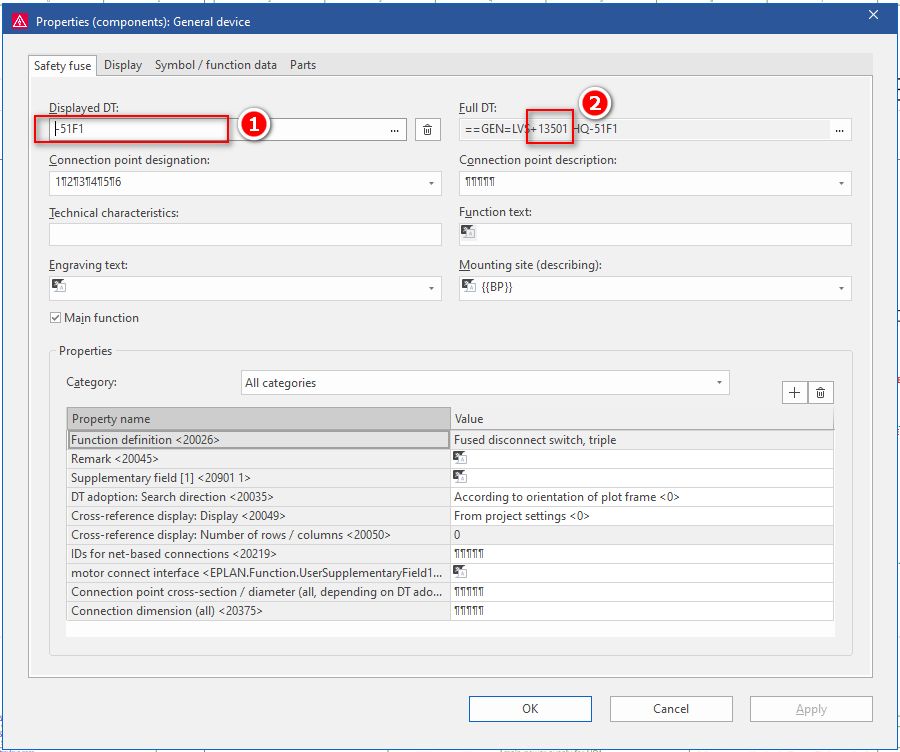
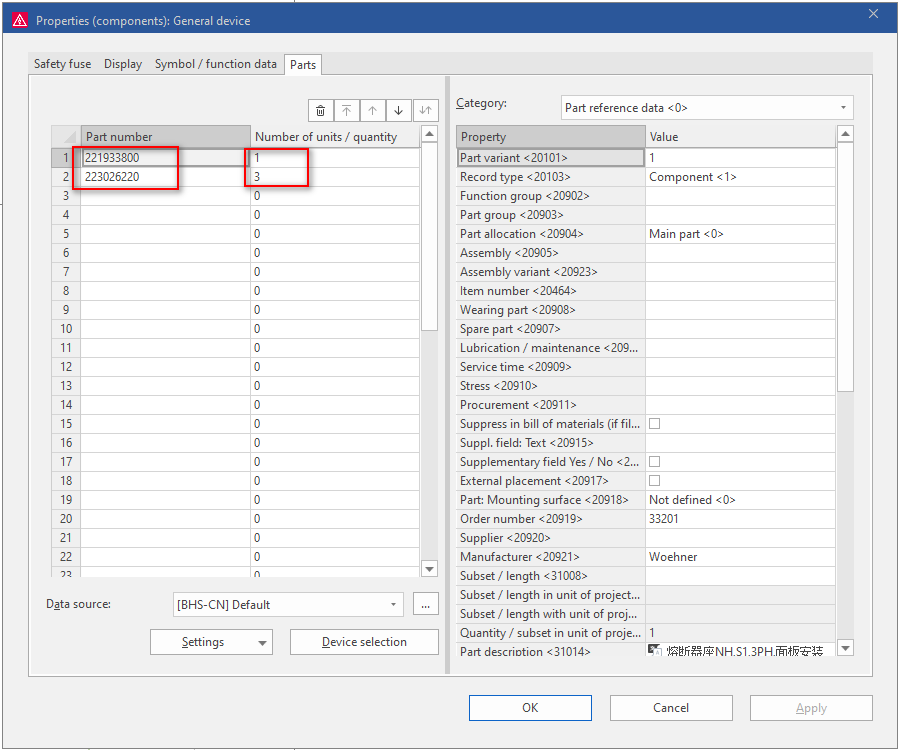
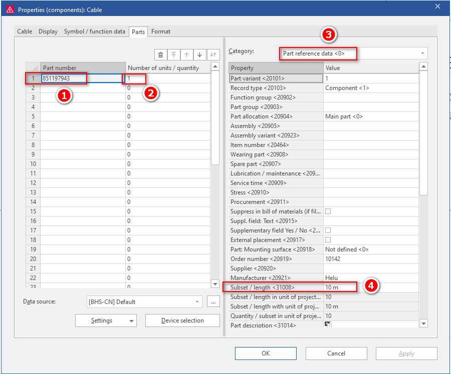
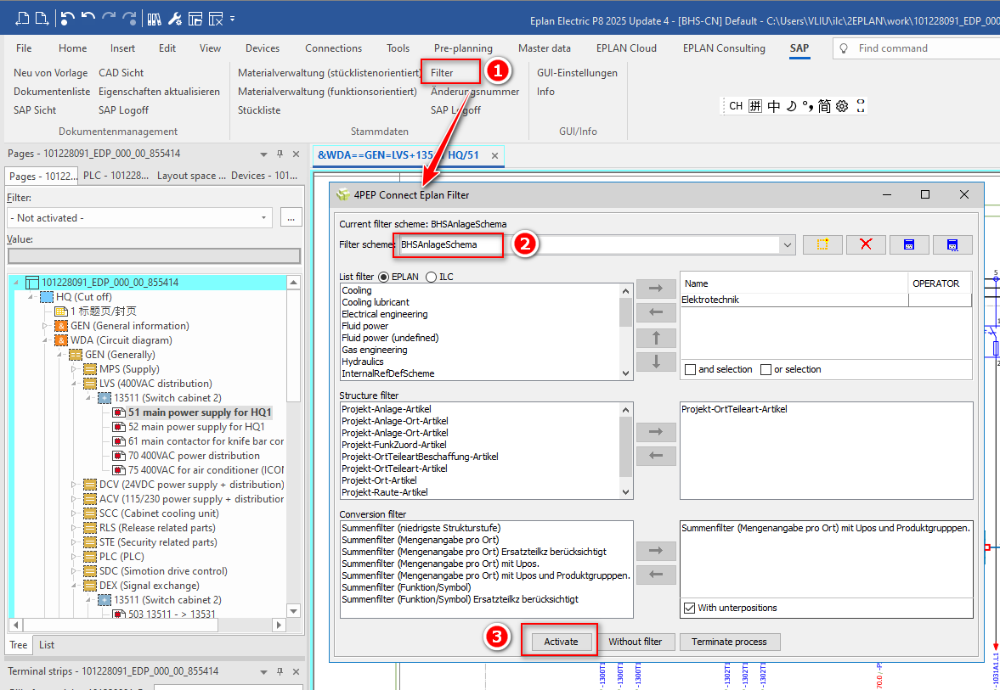
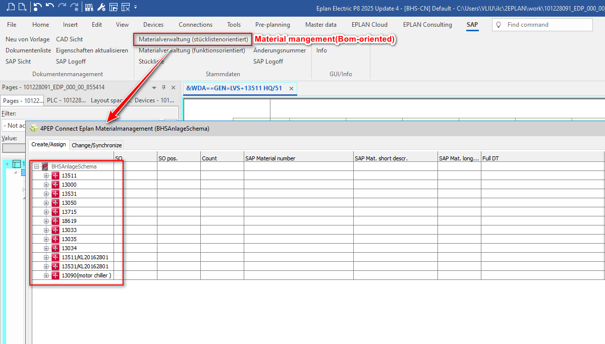
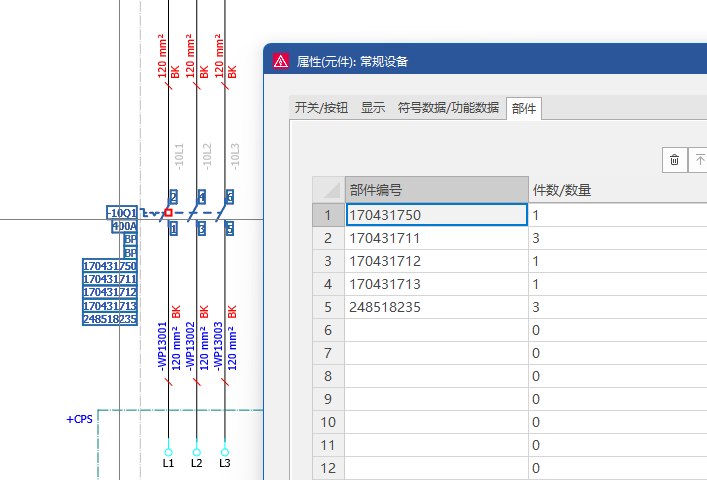
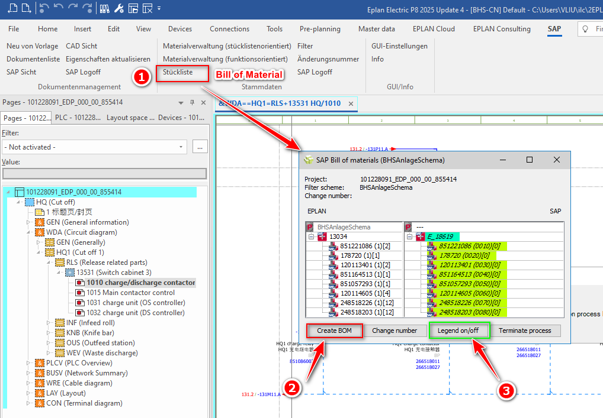
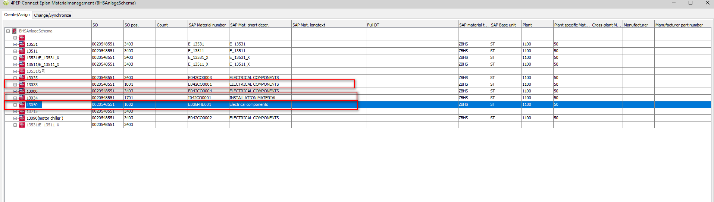
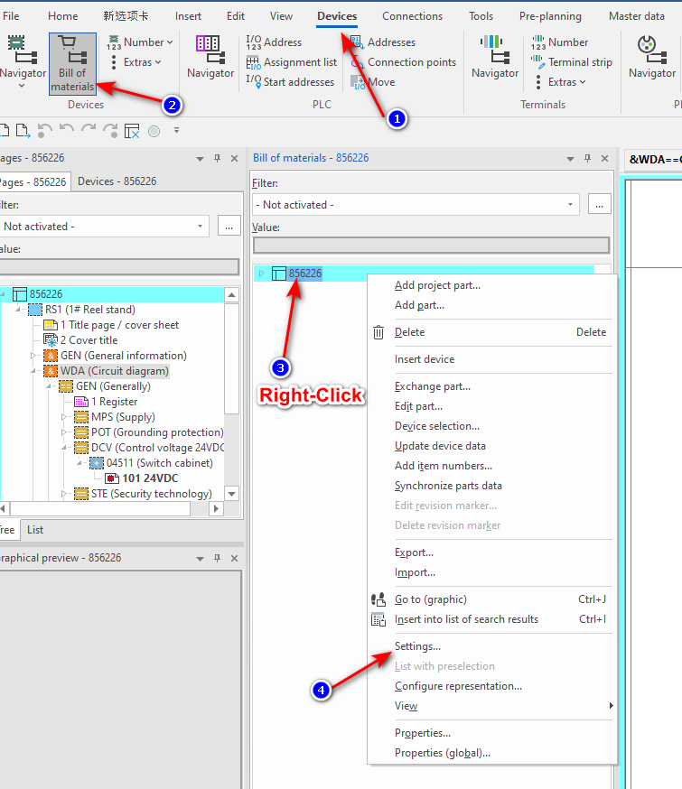
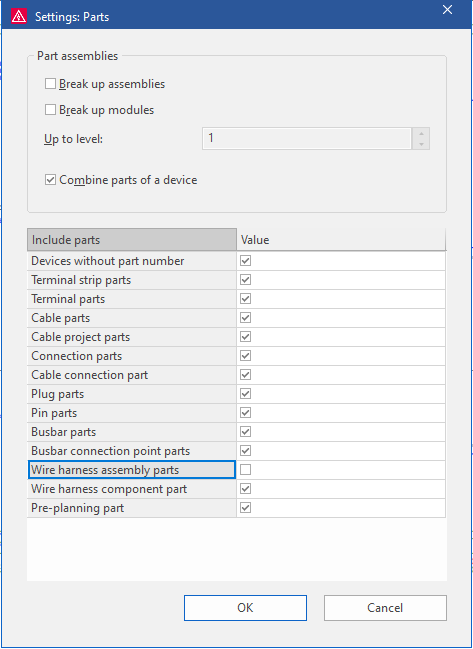

ILC 是 EPLAN 里的 SAP 接口插件。它把图纸里的位置代号和物料，按 SAP 的订单结构释放成 BOM。操作顺序只有一条：先定相关性，再挂订单，再分物料，再分物料组，最后建 BOM。

## A 五个概念
| 概念 | 含义 | 在哪看 |
|---|---|---|
| 位置代号 | 图纸中的柜号/安装位置，如 13511 | EPLAN 设备属性、Material management 左列 |
| 物料号 | EPLAN 部件库里的 Part number | 设备属性 Parts 页 |
| SAP Material number | SAP 主数据里的物料号 | Material management 右列 |
| SO / Item | 销售订单号与行项目 | Choose Sales Order 窗口 |
| BOM relevant | 该位置代号下的物料是否释放到 SAP | Material management 状态列 |

> 外部物料不要加位置代号；图纸里加不上位置代号时，先检查图纸结构设置。

## A2 释放前先在 EPLAN 补三样
ILC 只读取 EPLAN 里的数据。三样没补，后面全空。

| # | 补什么 | 在哪补 | 判据 |
|---|---|---|---|
| 1 | 位置代号 | 部件属性窗口 | 每个柜内件都有 +135xx |
| 2 | 物料号与数量 | 部件属性 Part 栏 | Part number 与数量非空 |
| 3 | 电缆长度 | 部件属性，电缆专用 | 长度单位 m |







> 外部物料（客户供货、现场散件）不要加位置代号。

> 图纸里加不上位置代号时，先检查图纸结构设置，再查结构标识。

## B 全流程与固定顺序
```flow LR
(EPLAN项目) -> SAP工具栏
SAP工具栏 -> Filter: 4PEP
Filter: 4PEP -> Material management
Material management -> BOM relevant/irrelevant
BOM relevant/irrelevant -> Assign SO Position
Assign SO Position -> Assign物料号
Assign物料号 -> Assign SO Material
Assign SO Material -> Bill of materials
Bill of materials -> Create BOM
```

| 顺序 | 命令 | 目的 |
|---|---|---|
| 1 | SAP → Master data → Filter | 选 4PEP Connect 过滤器 |
| 2 | Material management (BOM-oriented) | 按位置代号列出物料 |
| 3 | BOM relevant / BOM irrelevant | 标记哪些释放 |
| 4 | Assign SO Position / BOM | 挂销售订单与 Item |
| 5 | Assign | 补齐 SAP 物料号 |
| 6 | Assign SO Material | 把位置代号挂到 SAP 汇总物料/物料组 |
| 7 | Bill of materials → Create BOM | 写入 SAP |
| 8 | `Terminate process` | 关闭 |

> 三条铁律：父行（位置代号）挂 SO 与汇总物料，子行（下层物料）Assign 物料号；顺序不能反；Create BOM 前不能有空白或红色错误。

## C 第 1–2 步：打开项目与过滤器
| 操作 | 说明 |
|---|---|
| 在 Citrix 打开 EPLAN | 打开已释放的对应项目图纸 |
| 点标题栏 SAP | 检查 Master data 工具栏是否存在 |
| 点 Master data → Filter | 打开过滤器窗口 |
| Filter scheme | 选 BHSAnlageSchema |
| List filter | 选 4PEP Connect Eplan Materialmanagement |
| 点 Activate | 过滤器生效 |



## D 第 3–4 步：Material management 与 BOM 相关性
| 操作 | 说明 |
|---|---|
| 点 Material management (BOM-oriented) | 打开物料管理窗口，左列按位置代号分组 |
| 出现 Error 窗口 | 正常，提示重复/设置问题；点 OK 继续 |
| BOM irrelevant | 选中物料变灰，表示不释放到 SAP |
| BOM relevant | 灰色消失，恢复可导入 |
| 选择范围 | 可整栏、多栏或全选 |



> 先把不释放的物料设成 BOM irrelevant，再挂订单。顺序反了，灰/亮状态会把已挂的订单信息搞乱。

## E 第 5 步：Assign SO Position / BOM
| 操作 | 说明 |
|---|---|
| 选中要释放的位置代号 | 不是选单个物料 |
| 点 Assign SO Position / BOM | 打开 Choose Sales Order |
| 输入订单号与 Item | 与 SAP 订单一致 |
| 点 Read | 左侧出现对应 Item |
| 点 Apply (without material) | 挂订单，不分配物料 |
| 检查 | SO 列与 SO pos. 列出现订单号/Item |

> 要移除已挂的订单，选中物料后点 `Remove SO position Descending`。不要用删除行来“撤销”。

## F 第 6–7 步：Assign 物料号与物料组
| 操作 | 说明 |
|---|---|
| 左侧红框 | EPLAN 检索出的物料 |
| 右侧红框 | SAP Material number 列，导入 SAP 的物料 |
| 选中下层物料栏 | 不要选位置代号栏 |
| 点 Assign | 把物料号填到右列 |
| 点 Assign SO Material | 打开 Select material for “XX” |
| 选物料组 → OK | 位置代号旁出现物料组信息 |



> 同一位置代号下的物料必须归到同一个物料组；不同位置代号可以归到不同组。分错组，SAP BOM 结构会错。

## G 第 8 步：Bill of materials → Create BOM
| 操作 | 说明 |
|---|---|
| 点 Bill of Material | 打开 SAP Bill of materials |
| 检查 Project / Filter scheme | 项目与过滤器正确 |
| 点 Create BOM | 写入 SAP |
| Legend on/off | 切换颜色说明 |
| `Terminate process` | 关闭窗口 |



## H 释放前检查清单

> 完整 52 项改图/释放检查见 [24 改图检查表](24-review-checklist.html)。
| # | 检查项 | 通过标准 |
|---|---|---|
| 1 | 每个要释放的位置代号 | 都有 SO 与 Item |
| 2 | 每个位置代号下的物料 | 都分配了 SAP Material number |
| 3 | 不需要的物料 | 已设为 BOM irrelevant（灰色） |
| 4 | 电缆物料 | 已填电缆长度 |
| 5 | 外部物料 | 未加位置代号 |
| 6 | 汇总物料 | 每个位置代号已 Assign SO Material，位置行有 E_xxxxx |
| 7 | 重复/错误 | Error 窗口已确认，无未处理重复 |
| 8 | 一图多 Item | 已按 Item 分别挂单 |
| 9 | 隔离开关组件 | 本体+保护罩+手柄+延长杆+接线鼻（≥25mm²） |
| 10 | 端子排组件 | 端子+端板+终端固定+保护罩+标记卡+端子排标记卡 |

## I 常见错误与组件规则
| 现象 | 原因 | 处理 |
|---|---|---|
| 图纸加不上位置代号 | 图纸结构设置不对 | 检查结构标识/项目设置 |
| Material management 空白 | 过滤器没激活 | 重选 4PEP 过滤器并 Activate |
| 物料灰色无法导入 | 被设为 BOM irrelevant | 选中后点 BOM relevant |
| SAP Material number 空 | 未点 Assign | 选下层物料后 Assign |
| Create BOM 报错 | 有位置代号未挂单/未分组 | 回检查清单逐项补 |
| 订单号挂错 | 选错 Item | Remove SO position 后重挂 |
| 电缆数量不对 | 未填长度 | 在 Parts 页补长度 |

> 端子排物料导出：Devices 栏 → Bill of Materials → 右键项目 → Settings → 勾选除 Wire harness assembly parts 外的选项 → OK。

## J 一图多 Item 与端子排导出
一份图纸可以给多个 SO Item 供货。3401 只是其中一个 Item。

| 步骤 | 动作 | 检查 |
|---|---|---|
| 1 | 列位置 → Item → 汇总物料对照表 | 每个位置一行 |
| 2 | 父行 Assign SO Position / BOM | SO 与 Item 出现 |
| 3 | 父行 Assign SO Material | 位置行有 E_xxxxx |
| 4 | 子行 Assign 物料号 | 右列补齐 |
| 5 | 每个 Item 单独 Create BOM | 不重复建 |
| 6 | 每个 Item 导出 3401 核对 | 行数与图纸一致 |



| 端子排导出设置 | 动作 |
|---|---|
| 打开 | Devices 栏 → Bill of Materials |
| 右键 | 选中项目 → Settings |
| 勾选 | 除 Wire harness assembly parts 外全部勾选 |
| 确认 | OK 后重新导出 |





> 一图多 Item 时，批量 Apply 同一个 Item 会把 B 项物料挂到 A 项。

## 导航
[← 上一页：09 订单处理 SOP](09-order-workflow.html) · [知识库首页](index.html) · [下一页：11 项目实例 →](11-case-studies.html)
