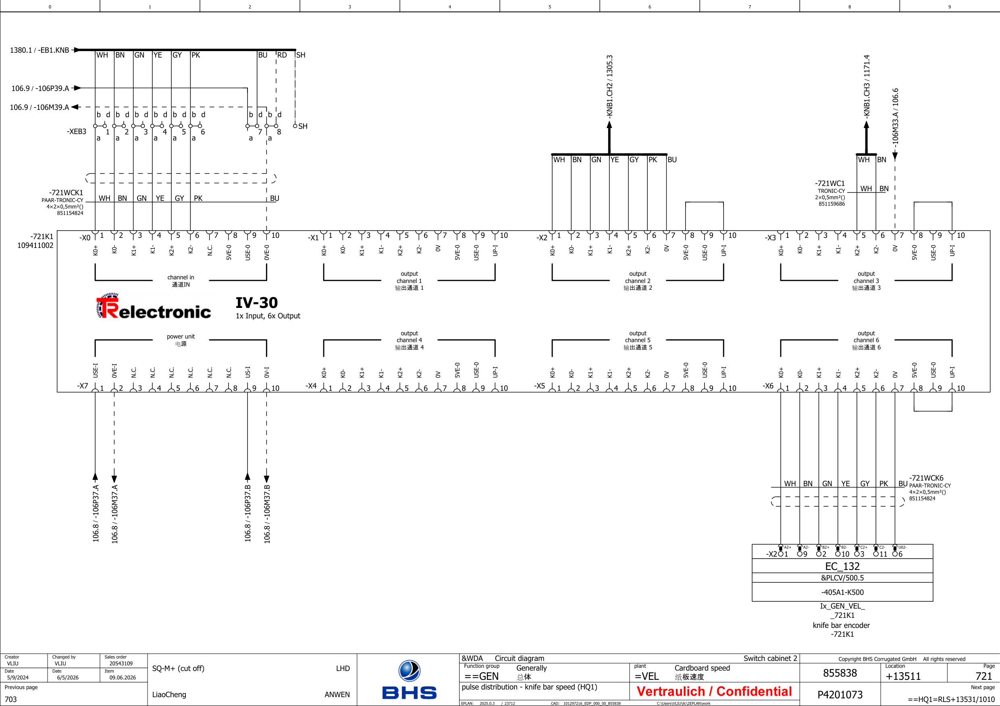
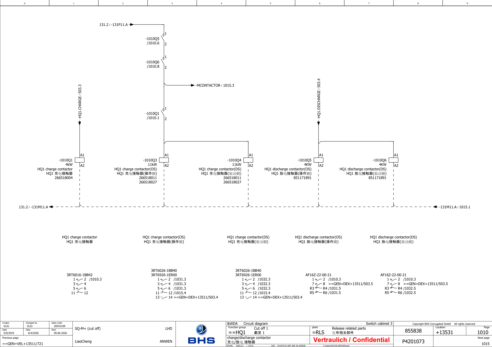
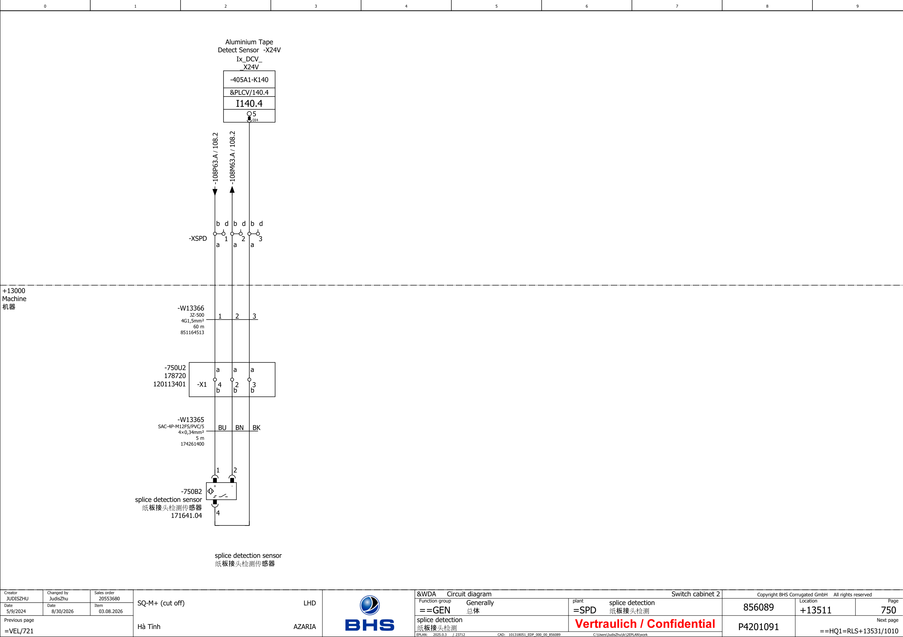

这是一道用**两个真实订单**构造的实战题：起始图纸是山东恒升 20543109（ANWEN，无 Splice），目标图纸是越南 20553680（AZARIA，有 Splice）。你要在起始图纸上追加 Splice Detection，然后拿 AZARIA 的真实 SPD 页对照。目标页不是人工画的，是 EPLAN 导出的正确图纸。

## A 任务背景
| 项 | 起始订单 | 目标订单 |
|---|---|---|
| 销售订单 / Item | 20543109 / 3401 | 20553680 / 3401 |
| 客户 / 项目 | 山东恒升 / ANWEN | 越南 CLC / AZARIA |
| 机型 | SQ-M+，Simplex | SQ-M+，Simplex |
| 幅宽 | 3350 mm | 2800 mm（本题不计） |
| 驱动侧 | Left / LHD | Left / LHD |
| 主传动 | 2×112kW 同步 | 2×112kW 同步 |
| 图纸页数 | 233 | 234 |
| Splice | 无 | 有（页 750） |

> 为什么选这一对：两套图纸页级几乎同构，目标项目只多 SPD 750 一页。宽度的差异不在本题评分范围；只评 SPD 相关页、器件、端子、电缆、IO 和 BOM。

## B 变更请求
> 订单 20543109 追加 Splice Detection（纸板接头检测）。
> 在 `=SPD` 功能组增加页 750。
> 增加传感器、端子箱、端子、两根电缆，接到现有 PLC 快速 DI 通道。
> 更新箱柜设备清单/BOM。
> 不改变主传动、安全链、柜体结构、宽度和其他选配。

| 交付物 | 要求 |
|---|---|
| 修改后的图纸 | EPLAN 改图，或 PDF 标注 + 变更清单 |
| 变更清单 | 页/设备/端子/电缆/IO/BOM 逐项列出 |
| BOM 差异 | 新增物料号、数量、层级 |
| 自检表 | 按 24 页/本题评分表逐项打勾 |

## C 你拿到的文件
| 文件 | 用途 |
|---|---|
| [起始图纸 ANWEN 全文](../HQ-PDF/ANWEN-20543109-山东恒升-SQ-M+.pdf) | 233 页原始图纸 |
| [目标图纸 AZARIA 全文](../HQ-PDF/AZARIA-20553680-越南-SQ-M+.pdf) | 234 页正确答案 |
| [起始页子集](training/task-01/base-anwen-focus.pdf) | ANWEN PDF 69–76、149、175、182、184 |
| [目标页子集](training/task-01/target-azaria-focus.pdf) | AZARIA PDF 69–76、150、176、183、185 |
| [目标 SPD 单页](training/task-01/target-spd-page-750.pdf) | 只含答案页 750 |
| [变更请求](training/task-01/change-request.md) | 模拟客户变更单 |
| [答案 key](training/task-01/answer-key.md) | 页/设备/端子/电缆/IO/BOM 标准答案 |
| [提交模板](training/task-01/submission-template.md) | 你填写的交付格式 |
| [BOM 差异 CSV](training/task-01/bom-diff.csv) | 新增 5 行物料 |
| [README](training/task-01/README.md) | 使用说明 |

## D 正确答案：目标页长什么样






目标页的关键元素：
- 页名：`splice detection / 纸板接头检测`，页号 750，功能组 `=SPD`，柜 `+13511`。
- 传感器：`-750B2`，物料 171641.04，`PROXIMITY SWITCH 10-30VDC`。
- 端子箱：`-750U2`，物料 178720，附件 120113401×2。
- 端子：`-XSPD` 1/2/3，a;b;d。
- 电缆：`-W13365`（174261400，5 m）、`-W13366`（851164513，60 m）。
- IO：`-405A1-K140`，EL1258，`I140.4`，DI4。

## E 页级差异
| 项 | 起始 ANWEN | 目标 AZARIA |
|---|---|---|
| SPD 页 750 | 无 | 有 |
| 页位置 | VEL 721（PDF 72）→ RLS 1015（PDF 73） | VEL 721（PDF 72）→ SPD 750（PDF 73）→ RLS 1015（PDF 74） |
| 页数 | 233 | 234 |
| 设备 | 无 -750B2/-750U2 | 有 |
| 端子 | -XSPD 预留/箱柜清单有 | -XSPD 1/2/3 接线 |
| 电缆 | 无 -W13365/-W13366 | 有 |
| IO | 无 SPD 信号 | I140.4 |
| BOM | 无 5 行 | 有 5 行 |

## F BOM 差异
| 动作 | 层级 | 物料号 | 描述 | 数量 | 单位 |
|---|---|---|---|---|---|
| 新增 | ...3 | 171641.04 | PROXIMITY SWITCH 10-30VDC | 1 | PC |
| 新增 | ...3 | 178720 | TERMINAL BOX 45/45 BH | 1 | PC |
| 新增 | ...3 | 120113401 | SCREWED JOINT M20 PG13,5 | 2 | PC |
| 新增 | ...3 | 851164513 | CABLE 4G1,5MM2 | 1 | PC |
| 新增 | ...3 | 174261400 | CABLE WITH PLUG -M12/4PIN/5M | 1 | PC |

> 端子 `-XSPD` 的端子/端板/标记卡等附件按 22 页规则补；BOM 里不一定单独成行。

## G 怎么练
```flow LR
(读变更请求) -> 打开起始图纸
打开起始图纸 -> 找插入位置: VEL 721 之后
找插入位置 -> 加页 750
加页 750 -> 加设备/端子/电缆/IO
加设备/端子/电缆/IO -> 补箱柜清单/BOM
补箱柜清单/BOM -> 对照目标页
对照目标页 -> 填提交模板
```

| 步骤 | 动作 | 检查 |
|---|---|---|
| 1 | 打开 ANWEN 全文/子集，定位 PDF 72（VEL 721） | 下一页是 RLS 1015，中间没有 SPD |
| 2 | 在 EPLAN 复制/新建页 750，页名、结构 | 与目标页一致 |
| 3 | 加 -750B2、-750U2、-XSPD、-W13365/-W13366 | 标签/物料/数量一致 |
| 4 | 接 I140.4 | 卡号 K140、通道 DI4 |
| 5 | 更新 &LAY 页 94 箱柜清单和 BOM | 5 行齐全 |
| 6 | 对照目标页图片/PDF | 逐项一致 |
| 7 | 填 submission-template.md | 自检/互检 |

## H 评分（100 分）
| 项 | 分值 | 标准 |
|---|---:|---|
| 页 750 页名/页号/结构 | 15 | 与目标一致 |
| -750B2 传感器 | 15 | 标签、物料号、数量正确 |
| -750U2/端子箱附件 | 10 | 178720 + 120113401×2 |
| -XSPD 端子 1/2/3 | 10 | a;b;d 连接正确 |
| -W13365/-W13366 | 15 | 型号、长度、物料号正确 |
| IO I140.4/EL1258 | 10 | 卡号/通道正确 |
| BOM 5 行 | 15 | 物料号/数量/层级正确 |
| 未复制无关内容 | 5 | 宽度/客户/其他选配未带入 |
| 文档/自检 | 5 | 提交模板完整 |

## I 重要限制
- 这是**模拟变更请求**，不是真实发生的变更单；起始/目标都是真实订单。
- 只评 SPD 相关页；AZARIA 的宽度、客户、其他选配差异不在本题范围。
- 目标页还显示 `-108P63.A / 108.2` 的交叉引用，属既有压力开关，不是本题新增项，不要误加。
- 如果只有 PDF，没有 EPLAN 源项目：用 PDF 标注 + 变更清单完成纸面练习；真正的 EPLAN 改图需要源项目。
- 改完必须按 [24 改图检查表](24-review-checklist.html) 和 [28 变更同步](28-change-closure.html) 做互检/释放检查。

## 导航
[← 上一页：29 上岗考核与带教](29-assessment.html) · [知识库首页](index.html) · [下一页：31 综合实战 CMC + 真空 →](31-training-task-2.html)
