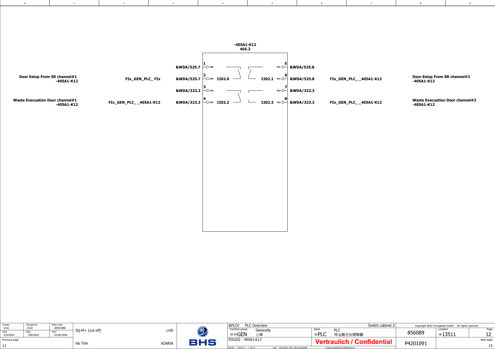
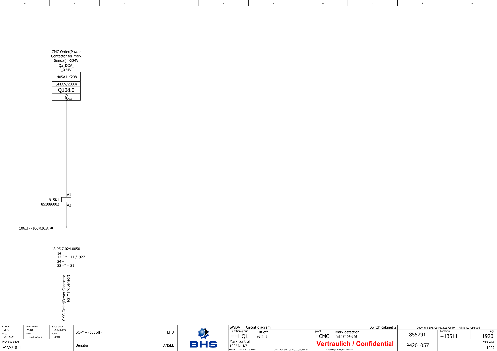
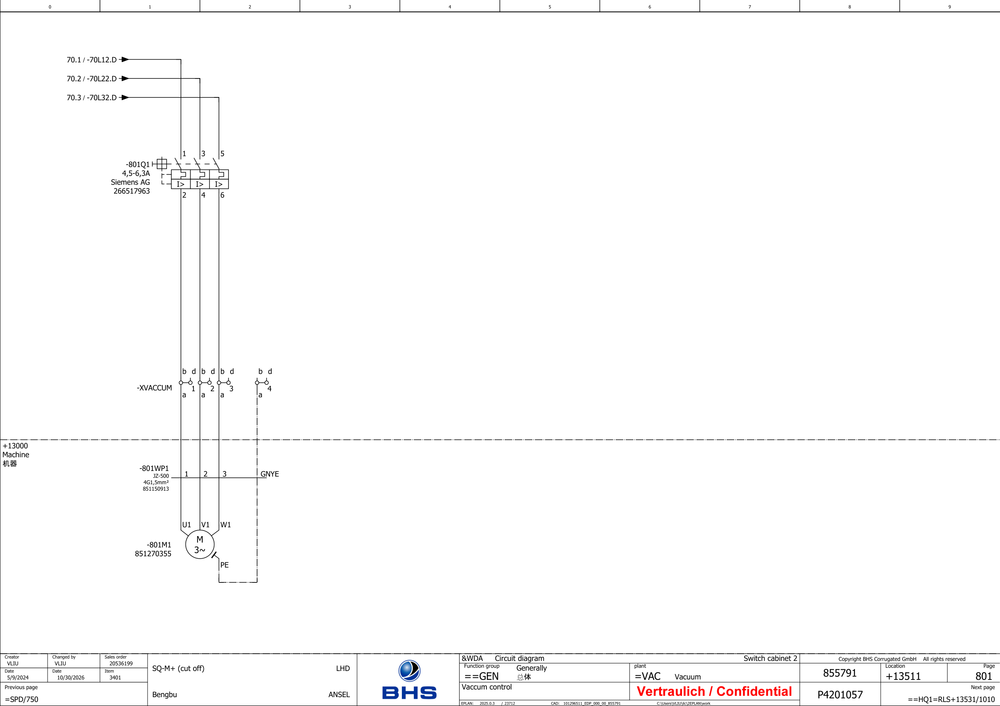

第二道实战更接近真实变更：不只加一页，而是加一整套 CMC 预印标记检测、真空控制和两个远程操作箱。起始是越南 AZARIA（234 页，无 CMC/真空），目标是蚌埠大美 ANSEL（249 页，有 CMC/真空），目标图纸是真实 EPLAN 导出。

## A 任务背景
| 项 | 起始订单 | 目标订单 |
|---|---|---|
| 销售订单 / Item | 20553680 / 3401 | 20536199 / 3401 |
| 客户 / 项目 | 越南 CLC / AZARIA | 蚌埠大美 / ANSEL |
| 机型 | SQ-M+，Simplex | SQ-M+，Simplex |
| 幅宽 | 2800 mm | 3350 mm（本题不计） |
| 驱动侧 | Left / LHD | Left / LHD |
| 主传动 | 2×112kW | 2×112kW |
| 图纸页数 | 234 | 249 |
| CMC / 真空 | 无 | 有（CMC 6 页 + VAC 1 页 + OUS 1 页） |

> 为什么选这一对：ANSEL 在 AZARIA 的 234 页核心上增加了 CMC、真空、远程操作箱等 15 页，跨 WDA、DEX、PLCV、LAY 四个文档块，适合做“综合改图”训练。

## B 变更请求
> 订单 20553680 追加 Cut-to-Mark（CMC 预印标记检测）。
> 同时追加真空控制和远程操作箱 +13711/+13730。
> 增加 CMC 六页、VAC 一页、OUS 真空一页、DEX 585/590、PLCV 107/208。
> 更新端子/电缆/箱柜清单/BOM。
> 不改变主传动、安全链、柜体结构、宽度和其他选配。

| 交付物 | 要求 |
|---|---|
| 修改后的图纸 | EPLAN 改图，或 PDF 标注 + 变更清单 |
| 变更清单 | 页/设备/端子/电缆/IO/BOM 逐项列出 |
| BOM | 主要新增物料，完整行以目标箱柜清单为准 |
| 自检表 | 按本题评分表/24 页检查表 |

## C 你拿到的文件
| 文件 | 用途 |
|---|---|
| [起始图纸 AZARIA 全文](../HQ-PDF/AZARIA-20553680-越南-SQ-M+.pdf) | 234 页原始图纸 |
| [目标图纸 ANSEL 全文](../HQ-PDF/ANSEL-20536199-蚌埠大美-SQ-M+.pdf) | 249 页正确答案 |
| [起始页子集](training/task-02/base-azaria-focus.pdf) | AZARIA PDF 66–67、76、107、113–118、130、136、158–164、167–171 |
| [目标页子集](training/task-02/target-ansel-focus.pdf) | ANSEL 同页段 |
| [目标 CMC 单页](training/task-02/target-cmc-page-1920.pdf) | 页 1920 |
| [目标真空单页](training/task-02/target-vac-page-801.pdf) | 页 801 |
| [变更请求](training/task-02/change-request.md) | 模拟客户变更单 |
| [答案 key](training/task-02/answer-key.md) | 页/设备/端子/电缆/IO/BOM 标准答案 |
| [提交模板](training/task-02/submission-template.md) | 交付格式 |
| [BOM 主要新增物料](training/task-02/bom-diff.csv) | 9 行主要物料 |
| [README](training/task-02/README.md) | 使用说明 |

## D 正确答案：CMC 页 1920




## E 正确答案：真空页 801


## F 页级差异（15 页）

> 15 页 = 12 个功能/接口页（CMC 6、VAC 1、OUS 1、DEX 2、PLCV 2）+ 布局/箱柜页。页序以目标 PDF 书签为准。
| 功能组 | EPLAN 页 | PDF 页 | 页名 | 关键内容 |
|---|---|---|---|---|
| =CMC | 1920 | 113 | Mark control | -1915K1、Q108.0 |
| =CMC | 1927 | 114 | Sensor control | -1927B1、-1927U1、XLSC |
| =CMC | 1930 | 115 | Sensor cleanning | -1920Y1、XCLEAN、W13507 |
| =CMC | 1950 | 116 | Mark move drive | -1950T1/-1950M1、XPOS1 |
| =CMC | 1951 | 117 | sensor postion limit | -1951B1–B3、XPOS2/3 |
| =CMC | 1952 | 118 | sensor postion limit | -1952B1、XPOS4 |
| =VAC | 801 | 76 | Vaccum control | -801Q1、-801M1、-XVACCUM |
| =OUS | 1696 | 107 | outfeed station vacuum control | -1696Y1、-1696WC1、-XVACU |
| =DEX | 585 | 66 | CMC remotecontrol 13711 <-> 13511 | -585U1、-585W1、-X585 |
| =DEX | 590 | 67 | CMC remotecontrol 13730 <-> 13511 | -590U1、-590WC1、-X590、-XCMC2 |
| =PLC | 107 | 130 | DI 107 - 405A1-K107 | CMC 输入 |
| =PLC | 208 | 136 | DO 108 - 405A1-K208 | CMC 输出 |
| =LAY | 160–171 | 160–171 | 布局/箱柜清单 | +13711/+13730、CMC/VAC 设备 |

## G 主要设备、端子、电缆、IO
| 类别 | 内容 |
|---|---|
| CMC 设备 | -1915K1 851086002、-1927B1 650142.05、-1920Y1 查清单、-1950T1 851129369、-1950M1 851239155、-1951B1–B3 / -1952B1 851060083 |
| 真空设备 | -801Q1 266517963、-801M1 851270355、-1696Y1、-801WP1 851150913、-1696WC1 851150910 |
| 端子 | XLSC、XCLEAN、XPOS1–4、XVACCUM、XVACU、X585、X590、XCMC2 |
| 电缆 | W13335/W13337/W13339/W13507、1927WC1、1600WD1/WP1、585W1、590WC1、801WP1、1696WC1 |
| IO | CMC: K107 DI、K208 DO、Q108.0；真空: 801Q1/M1、1696Y1 Q104.6 |

## H BOM 主要新增物料与评分
| 物料号 | 描述 | 数量 | 用途 |
|---|---|---|---|
| 851086002 | RELAY 2WE/24VDC/8A | 1 | CMC |
| 650142.05 | Mark sensor | 1 | CMC |
| 851239155 | SERVOMOTOR 1KW/1.7NM/5500R/MIN | 1 | CMC mark move（-1950M1） |
| 851129369 | SERVO CONTROLLER i950 2.2kW | 1 | CMC |
| 851060083 | Sensor | 4 | 位置限位 |
| 266517963 | Motor protection 4.5–6.3A | 1 | 真空 |
| 851270355 | Vacuum motor | 1 | 真空 |
| 851150913 | CABLE JZ-500 4G1.5 | 1 | 真空 |
| 851150910 | CABLE JZ-500 3G1.5 | 1 | 出料真空 |

| 评分项 | 分值 | 标准 |
|---|---:|---|
| 15 页页号/页名/结构 | 20 | 6 页 CMC + 801 + 1696 + 585 + 590 + 130 + 136 |
| CMC 设备 | 20 | 1915K1/1927B1/1920Y1/1950T1/1950M1/1951B1–B3/1952B1 |
| 真空设备 | 15 | 801Q1/801M1/1696Y1 |
| 端子 | 15 | XLSC/XCLEAN/XPOS1–4/XVACCUM/X585/X590/XCMC2 |
| 电缆/IO | 15 | 主要电缆、K107/K208、Q108.0 |
| BOM 主要物料 | 10 | 9 行主要物料 |
| 未复制无关内容 | 5 | 宽度/客户/其他选配未带入 |

## I 怎么练与限制
```flow LR
(读变更请求) -> 加 CMC 六页
加 CMC 六页 -> 加真空两页
加真空两页 -> 加 DEX/PLCV
加 DEX/PLCV -> 端子/电缆
端子/电缆 -> 箱柜清单/BOM
箱柜清单/BOM -> 对照目标页
```

- 先做 CMC 六页，再做真空两页，最后做 DEX/PLCV/LAY；一次只攻一个功能组。
- 目标页 1920/801 是真实 ANSEL 图纸；完整目标页在 `target-ansel-focus.pdf`。
- ANSEL 现有 BOM/20536199.xlsx 可查；其中 -801Q1、-801M1、-1696Y1 未出现在箱柜清单，正是本题要发现的 BOM 缺口。
- 只评 CMC/VAC/DEX 585/590/PLCV/端子电缆/BOM 范围；宽度 3350 vs 2800、客户、其他选配不计。
- 改完按 [24 改图检查表](24-review-checklist.html) 和 [28 变更同步](28-change-closure.html) 做互检/释放检查。

## 导航
[← 上一页：30 实战任务 ANWEN 追加 Splice](30-training-task.html) · [知识库首页](index.html) · [下一页：32 图纸英语入门 →](32-english-basics.html)
